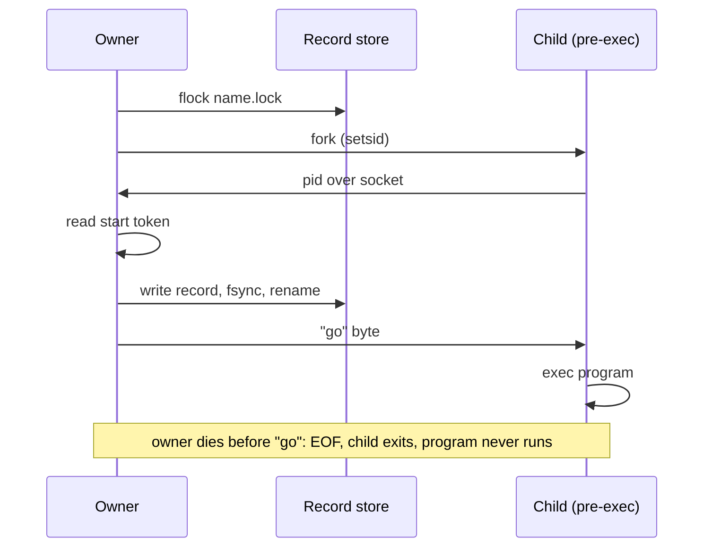

# 0023 — Service mode and kept processes

Status: accepted.

Applications kept rebuilding the same loop around Shepherd: start a helper, wait
until it answers, restart it with backoff when it dies, and publish its state. Some
helpers must also survive their owner. A tunnel client keeps its public address only
while it runs, so restarting the application must not restart the tunnel. The core
invariant forbids both: every process belongs to a scope that dies with its owner,
and restart policy and persistence are non-goals of the core.

## Decision

Two opt-in layers on top of the core. Nothing changes for callers that do not use
them.

**Kept processes** (`KeptProcesses`, Linux and macOS). A kept process is owned by a
durable `KeptRecord` instead of a scope. The core invariant becomes: every process
Shepherd starts belongs to exactly one scope *or exactly one kept record* until it is
confirmed gone.

- The record is written before the program may run. The child calls `setsid`,
  reports its pid over a private socket and blocks before `exec`. The owner reads the
  start token, writes the record (temporary file, `fsync`, `rename`, directory
  `fsync`) and only then sends one "go" byte. If the owner dies first, the socket
  reaches EOF and the child exits without running the program.
- One live owner per name, by an exclusive `flock` on `<name>.lock`. The kernel
  drops it when the owner dies, so a crash never blocks adoption.
- Identity is pid + start token (+ boot id on Linux, where tokens restart at boot).
  The executable path is recorded for display but is not identity: a process that
  execs another program is the same instance, and calling it gone would orphan it.
  An identity that exists but cannot be read is an error, never "gone".
- `list` shows every live kept process and whether an owner holds it. It removes a
  record only when its process is gone and no owner holds the name. `adopt` attaches
  a later owner. A dropped or released `KeptProcess` leaves the process running.
- Exit is observed without reaping (pidfd on Linux, kqueue on macOS, polling
  otherwise). The process group is swept with `SIGKILL` while the exited leader still
  pins it, then the leader is reaped if it is this process's child (including one
  inherited across `execve`). After the owner dies the kept process belongs to init,
  its exit status is unknown, and the sweep is best effort.
- Output cannot be piped to an owner that may go away, so kept processes take a log
  file instead of `OutputMode::Capture`.

**Service mode** (`ServiceSupervisor`, all platforms). A `Service` describes each run
(`launch`) and checks it (`ready`, which returns a value such as an address). The
supervisor publishes `ServiceStatus` on a `watch` channel, restarts on exit or missed
readiness with `RestartPolicy` backoff, and can give up after a set number of
consecutive failures. Each run lives in its own scope by default. With
`ServiceOptions::kept`, each run is a kept process; the first start adopts the
previous run when its `SpecFingerprint` (spec plus a caller revision) still matches,
and stops it otherwise. `stop(Terminate)` ends the run and its tree;
`stop(Leave)` and dropping the handle leave a kept run running for the next owner.

## Consequences

- Restart policy and persistence remain caller choices: the caller picks the backoff,
  the readiness check, the record directory and whether a run is kept.
- Kept processes are refused on Windows (`KeptError::Unsupported`) until a Job Object
  design exists that survives its creator; service mode works there with scoped runs.
- On Linux a kept process stays in its owner's cgroup. A service manager that kills a
  whole cgroup on stop (systemd's default `KillMode=control-group`) also kills kept
  processes; such owners need `KillMode=process` or a separate unit.
- After the owner dies, descendants that left the kept process group (`setsid`) are
  not tracked, as with the process-group fallback (ADR 0019).
