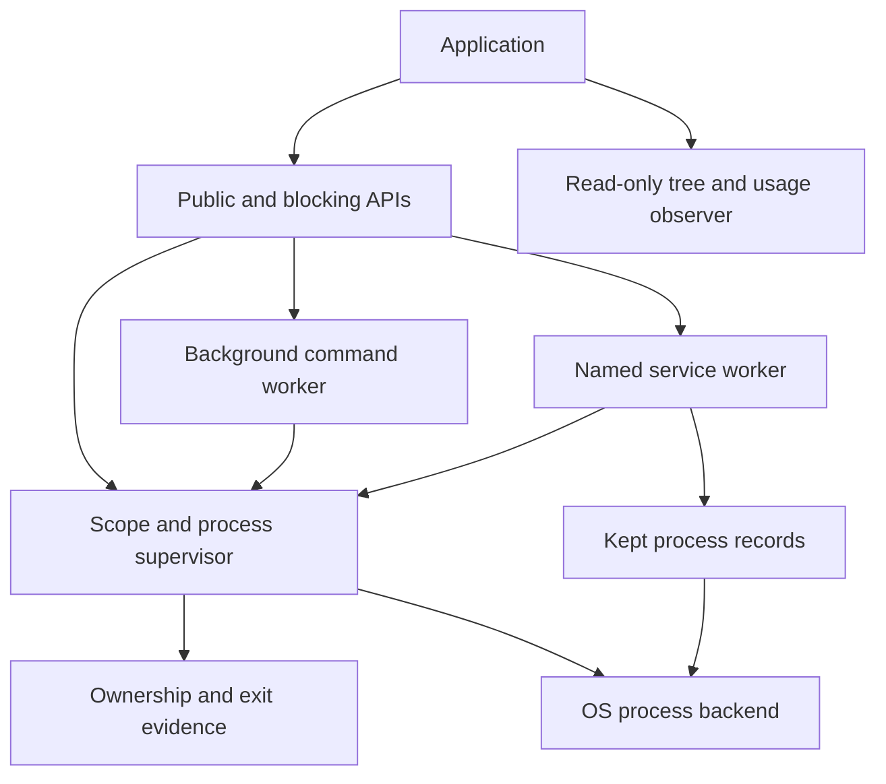

# Shepherd

Shepherd starts operating-system processes and keeps responsibility for cleaning
them up. For example, an application can start a development server, use it while
a workspace is open, and ask Shepherd to stop the server and its contained
children when the workspace closes. A successful request to stop is not yet proof
that those processes are gone; the cleanup report supplies that evidence.

There are three choices for running work. Use an ordinary scope for a group that
must end together, a background task for a single command with a timeout and
retained output, or a service for a named program that should restart. Kept
services can deliberately survive their owner and therefore need a durable record.
An orderly release and a failed termination have different record outcomes; follow
the kept-process page before deciding what a later owner can recover.

## Choose a goal

- [Run and stop a group of processes](scope-cleanup.md).
- [Understand a spawn racing with shutdown](admission.md).
- [Run a background command and keep its result](background-tasks.md).
- [Keep a named service ready](services.md), optionally [across owner restarts](kept-processes.md).
- [Read command output](output.md) or [inspect a process tree](observation.md).
- [Measure resource use](statistics.md), or [call from synchronous Rust](blocking.md).
- [Choose platform guarantees](platforms.md) and [understand events and history](events-history.md).

## Where responsibility lives

The domain crate records ownership and exit evidence without OS calls. The
application crate serializes operations and owns workers. Infrastructure adapters
perform signals, waits, output capture and measurements. The public crate wires
them together. Caller policy includes which programs may run, concurrency limits,
persistent application records and when shutdown should begin.

The [feature inventory](inventory.md) maps the full public surface and support
folders. The [verification report](verification.md) separates source review,
executed checks and platform tests that were not run here.
