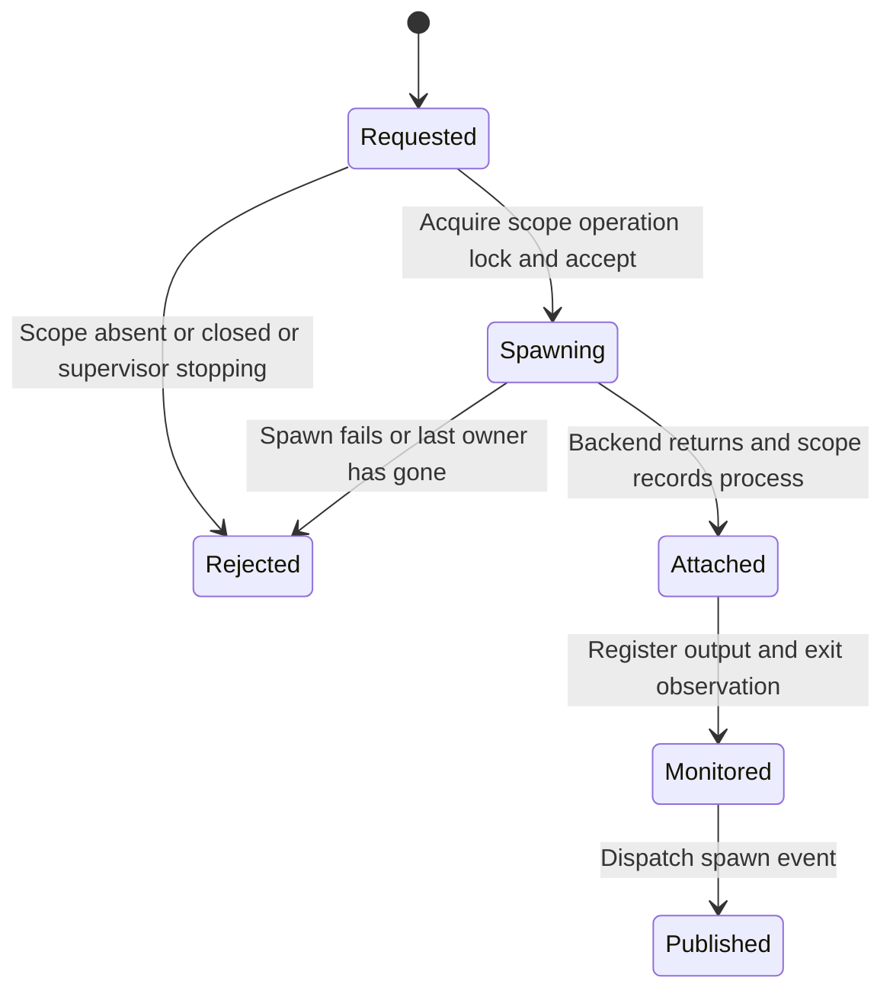

# Start work while ownership is still open

Suppose a user opens a terminal while the application is shutting down. Shepherd
either rejects the new work or keeps the accepted process under a scope that
shutdown can find. Losing the caller's future must not make the process invisible.

## Two admission decisions

Creating a scope checks the supervisor shutdown flag while holding the registry
lock. It allocates the scope and its operation lock before publishing it. Rejected
creation allocates neither. The fallible APIs return `SupervisorClosed`; the older
infallible convenience methods panic after shutdown begins.

Spawning then acquires that scope's operation lock, checks completed cleanup,
shutdown and the open aggregate, and calls the backend. Ordinary cleanup uses the
same lock, so it waits for an accepted spawn. If the last owning supervisor has
been dropped while the backend was spawning, a hard-kill sweep and orphan cleanup
handle the late result. Attachment failures also trigger orphan cleanup.

## Observation is handed over before events

For an observed spawn, output and an exit waiter are transferred immediately after
attachment, before the monitor can finish or event dispatch can suspend. The
monitor starts before dispatch. A slow event publisher therefore does not delay
the start of ownership monitoring. `spawn_observed` runs its work in a separate
worker; dropping the observer leaves the accepted child with that worker.

## Shutdown and limits

Shutdown closes admission first, serializes repeated calls, snapshots each scope
with its operation lock, and terminates those scopes. Unverified cleanup returns
an error. Only a verified shutdown then aborts and joins the shared sampler.
Dropping the last owner has a synchronous hard-kill backstop, but cannot promise
asynchronous reaping after runtime teardown. Retain a running runtime and await
shutdown when verified cleanup matters.

This interaction is source-reviewed here. The [scope model](scope-cleanup.md)
checks evidence handling after attachment; it does not prove the async locking,
late-spawn backstop or shutdown implementation. Launch and application regression
tests are the implementation checks for these races.
