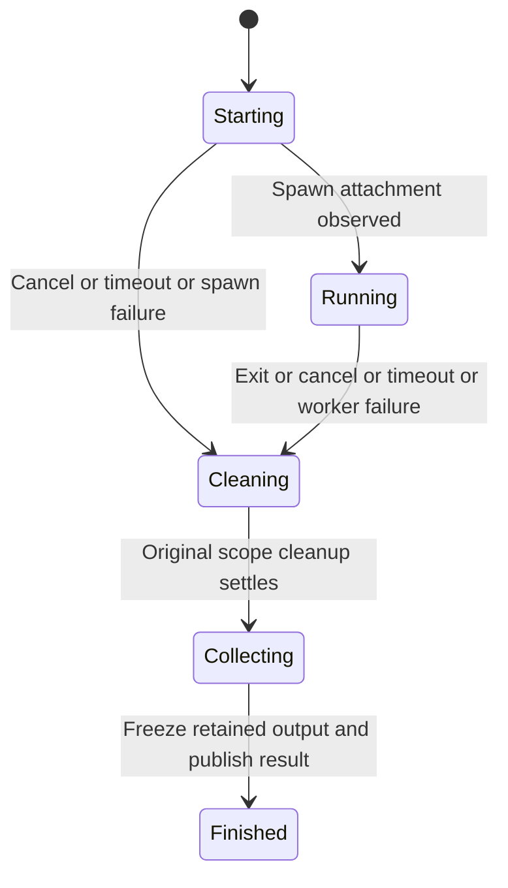

# Run a command without holding its wait open

A caller can start a long build, show its current output, and return to the UI.
Dropping the task handle or cancelling `wait()` does not cancel the build. Explicit
`task.cancel()` requests cleanup and returns no result. Await `task.wait()` to
obtain the retained result, then inspect `result.cleanup_verified()`.



## Deadline and ownership

Starting first admits an observed scope. A shutdown rejection creates no worker.
The timeout begins at admission and covers spawn plus execution. Capture is
replaced with a bounded combined stdout/stderr queue and tail. The caller, not
Shepherd, limits how many background tasks may be admitted.

The worker records why it stopped waiting separately from whether a process
physically exited. A cancellation can win before spawn attachment is observed;
cleanup still joins the in-flight spawn through its original scope. After cleanup,
the worker recovers an already-transferred observation when needed.

## Request and observe cancellation

For a running task, request cancellation and then wait for the worker to settle:

```rust
// Inside async code, with a BackgroundTask named task:
task.cancel();
let result = task.wait().await;
if !result.cleanup_verified() {
    // Preserve and report result.cleanup; do not claim the process is gone.
}
```

Repeated waits return the same settled result. Cancelling only the wait future
leaves the command running; keep a task handle to inspect or cancel it later.
The [complete example](../../crates/shepherd/examples/background_task_cleanup.rs)
constructs the supervisor and task, requests cancellation, and awaits shutdown.
It accepts a trusted program and arguments, and is compile-checked in this run;
the example itself was not executed.

## Finished does not mean successful

The finished result retains cause, optional process and exit, cleanup result, and
output. Even an `Ok` cleanup report may be unverified: use `cleanup_verified()`.
For example, a timed-out build can have verified forced cleanup, while a naturally
exited root can still leave uncertain cleanup of its group.

Output collection waits at most one additional second for capture closure. This
extra budget leaves still-open flags unchanged when it expires. Separately, the
native reader may already have been aborted and marked closed with an error.
Closed flags therefore do not prove complete output: inspect errors and omitted
bytes too, as explained in [output](output.md).
Panic handling preserves a finished result with errors when possible. Retained
results live with task handles, not in a persistent task registry. Tasks neither
restart automatically nor survive the supervisor's host process.

## Model scope

`TaskFinalization` checks the ordering from a stop cause through cleanup to a
published result and keeps uncertainty independent of completion. It has one
abstract task, with no OS calls or wall-clock proof. Its controls publish
finished data before cleanup settles or settle a task without recording a stop cause. Spawn ownership is explained in
[admission](admission.md); bounded bytes are covered by [output](output.md).
