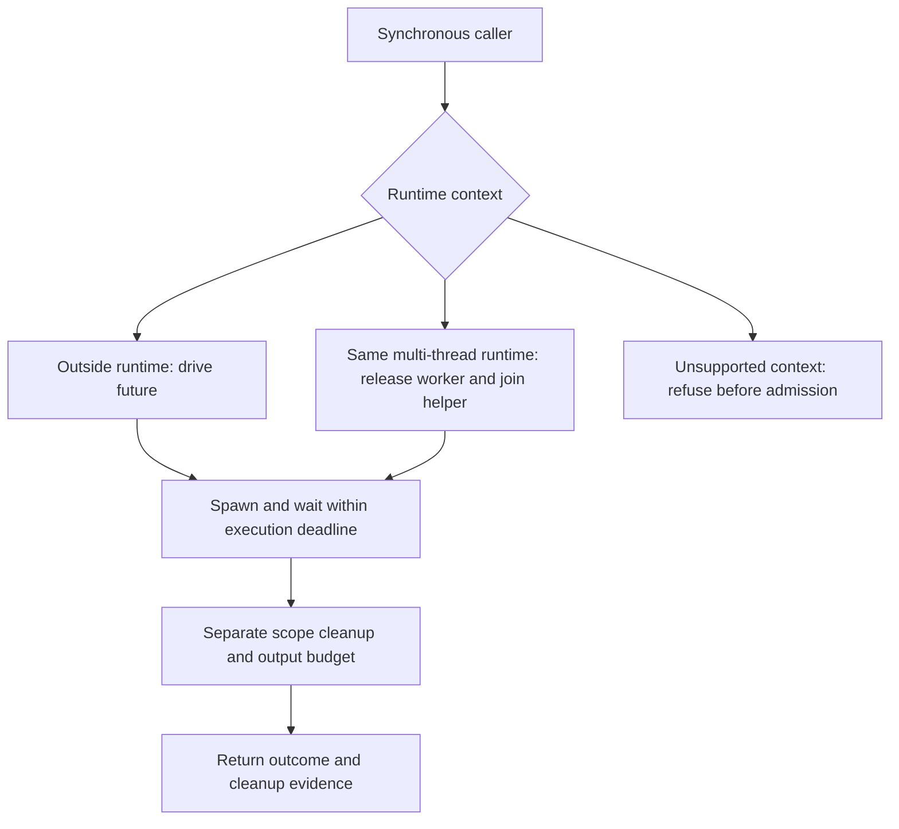

# Call from synchronous Rust

A command-line tool without Tokio can use `BlockingSupervisor` to run a command
and wait for its result. The wrapper owns a small multi-thread runtime or borrows
a supplied runtime handle. It must not naively call `block_on` on a thread already
driving that runtime.

## Choose the appropriate entry point

Same-runtime multi-thread calls use `block_in_place` before joining a helper.
Same-runtime `LocalSet` calls are unsupported and are refused before process
admission. A current-thread handle cannot be driven by its already-running thread.
Use the async API in those contexts or move blocking work to `spawn_blocking` as
supported by the surrounding runtime.

## Execution deadline versus total call duration

`run` applies its deadline to spawn plus wait, not just the child runtime after
spawn. Expiry triggers scope cleanup. Cleanup and output collection have separate
budgets, so total elapsed time can exceed the execution deadline. Natural root
exit also cleans the scope so surviving descendants are not ignored.

Inspect `all_verified()` and the retained output status. A returned timeout tells
you why execution waiting stopped; it does not erase unverified cleanup evidence.
The blocking facade shares [scope ownership](scope-cleanup.md) and
[output contracts](output.md), rather than owning another process lifecycle.
