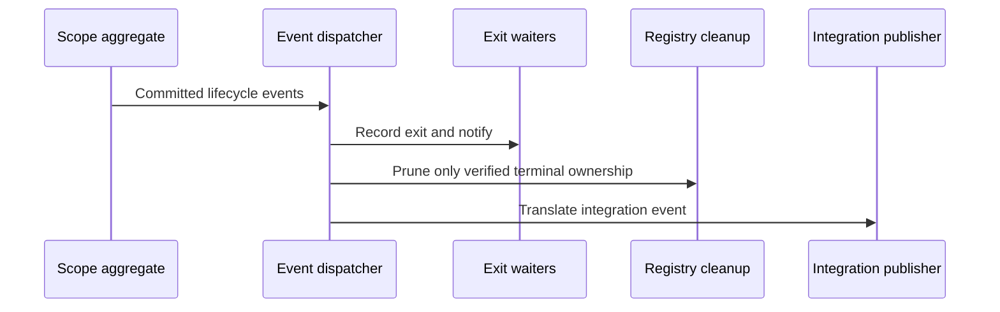

# Observe lifecycle changes

A caller waiting for a process exit should not need to race the exact moment the
process finishes. Shepherd retains recent completed results and wakes waiters
from committed domain events. This is in-memory notification, not a durable event
log or a guarantee that every external subscriber receives every event.

## Failure and correction

Handlers run in deterministic order. An error is logged and does not prevent later
handlers from running. A failed wait can produce unverified exit evidence; the
notifier checks that the registry still contains that uncertainty before
publishing an older failure. This avoids resurrecting a stale unverified result
after a verified correction was processed and removed.

## Retention is bounded

Completed exits, scope reports, cancellation reports and unclaimed completed
output retain up to 256 entries per category. Keep returned results or take an
output observer when longer retention matters. Live or unverified ownership must
not be evicted to satisfy a history bound. An observed scope retains its own
original cleanup report independently of bounded lookup history.

The default integration publisher does nothing. A configured broadcast publisher
has its own delivery behavior and is not a persistent audit trail. Applications
that need durable history must save it themselves. Model coverage is shared with
[scope cleanup](scope-cleanup.md) for pruning evidence; dispatch scheduling,
broadcast lag and eviction correctness remain implementation test concerns.
