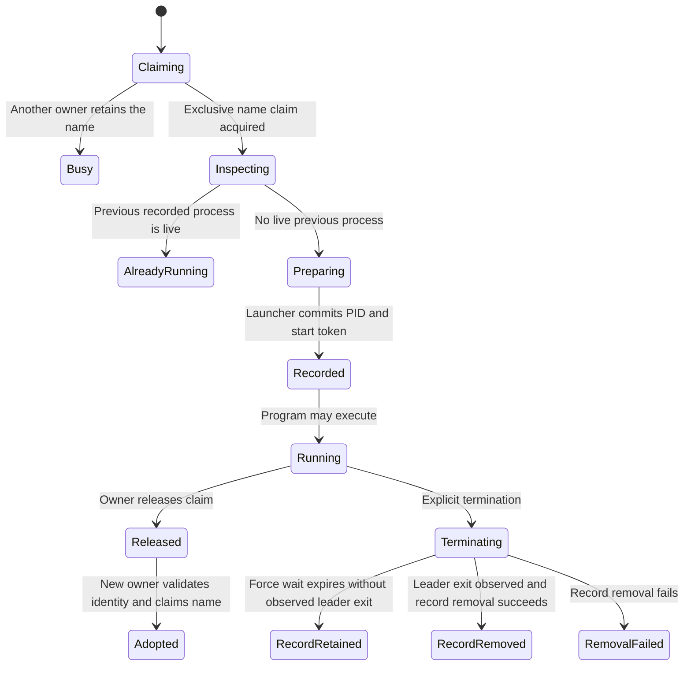

# Leave a process for the next owner

A tunnel may need to keep running while its desktop application restarts. Kept
processes support this deliberately: they have a named record on disk and an
exclusive owner claim. The next application instance can inspect and adopt them
instead of launching a duplicate.

## Record before execution

Start rejects captured output for kept processes; use the log option instead.
It claims the name, reads any previous record and asks the launcher to validate
whether that process is still live. A live predecessor returns `AlreadyRunning`.
The launcher must commit the new record before allowing the program to execute.
If launch fails, the application removes a possible pre-exec record. Updating the
executable path afterward improves the record; failure of that rewrite is logged
without discarding the already durable record.

The record binds PID, start token and boot identity, plus command fingerprint,
owner, revision, log and graceful signal. An OS PID by itself is insufficient
authority to adopt or signal a process. Platform validation can still fail; treat
store or launcher errors as errors, not evidence that the old process is gone.

## Adoption, listing and races

Adoption holds the name claim and validates the recorded process. A stale record
is removed only after the launcher reports it absent. Listing probes names and
reports whether another owner holds each live record. Before deleting a stale
record, it reacquires the claim and rereads the record: another owner could have
restarted the service while listing was inspecting it.

The short claim retry is intended to wait out listing's temporary lock, not to
steal a live owner's claim. Releasing a handle preserves the process and record.
Explicit termination reports an outcome; unverified termination must not be
reported to the caller as successful cleanup.

## Inspect what termination left behind

The returned termination outcome and the fate of the record are separate facts:

| Observed outcome | Record and safe next decision |
| --- | --- |
| Force wait expires without leader exit | Record is retained and the consumed handle releases its claim. A later owner may inspect/adopt it through the normal identity checks; do not assume it is still live. |
| Leader exited, no remaining group members observed | Record removal is attempted; inspect the returned outcome for verification. |
| Leader exited but group members remain after the sweep | Outcome is unverified and record removal is attempted because the old leader identity cannot safely address those members. Do not blindly signal the old PID or assume re-adoption can recover them. |
| Record removal fails | Outcome is unverified; preserve the store/cleanup failure and inspect through the supported APIs before retrying. |

A missing record is not proof that every descendant was cleaned up. Preserve
unverified outcomes for the application/operator rather than report success or
invent a universal retry procedure. The chart's `RecordRemoved` state describes
bookkeeping only and can still have an unverified cleanup outcome.

## Model scope

`KeptPublication` chooses one of two separate scenarios: launch ordering or a
listing race. The launch scenario checks execution happens after a durable-commit
acknowledgement. It assumes that acknowledgement belongs to this launch. The
listing scenario assumes an actually absent predecessor and serialized name
claims; it checks that two record generations cannot be confused when pruning.
It does not prove those assumptions or combined live-process/record integrity.
OS identity, filesystem durability and crash consistency remain adapter obligations.
Controls allow execution before commit and remove the listing generation comparison.
