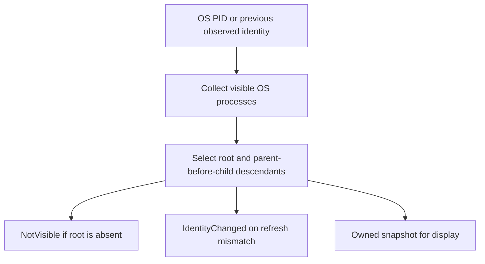

# Inspect a process tree

To display a program's children, pass its OS PID to `process_observer().tree()`.
For a managed process, first translate Shepherd's logical process ID with
`supervisor.os_pid()`. These identifiers are different; mixing them can select an
unrelated process.

## What a snapshot means

Observation is on demand and read only. It neither registers a scope nor sends
signals, waits, adopts or polls in the background. Dropping an observer leaves
processes alone. Tree selection avoids cycles and rejects known stale parent
links where the reported parent started after its child.

Enumeration is non-atomic and constrained by permissions. A short-lived or hidden
process may be missing; reparented historical descendants cannot be reconstructed.
`NotVisible` is not proof of exit. Refresh compares the reported root identity,
but coarse or absent start times cannot exclude every PID reuse. Use these results
for display and measurement, never as authority to kill or reap.

If refresh reports changed identity, obtain a new snapshot and explain the change
to the caller. Do not silently treat the replacement PID as the old managed task.
This page describes immutable returned snapshots, not a persistent observer
lifecycle; source tests cover tree ordering, cycles and identity comparisons.
