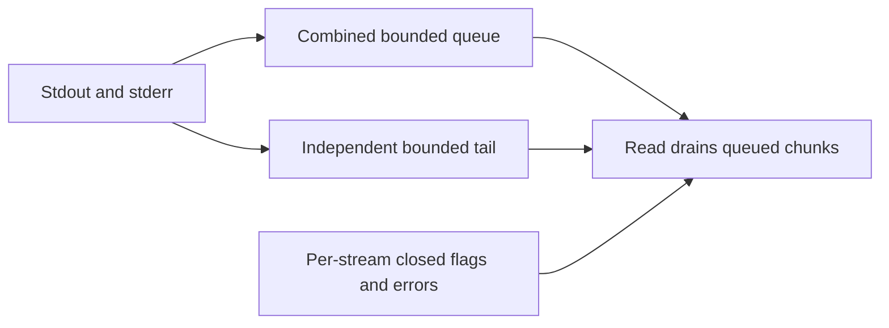

# Read output without blocking the child

A command can print faster than the UI can read. Shepherd retains a fixed amount
of recent output and counts omitted bytes instead of letting memory grow without
bound. Both stdout and stderr consume the same queue budget; stream labels remain
attached to their bytes. Dropped output alone does not mean the command failed.

For ordinary spawns, capture is opt-in: configure
`ProcessSpec::output(OutputMode::Capture { buffer_bytes, tail_bytes })` before
spawning. The default is `Discard`, so later reads cannot recover those bytes.
[Background tasks](background-tasks.md) enable bounded capture automatically;
[kept processes](kept-processes.md) reject capture and use a log instead.
The diagram below describes capture mode.

## Queue and tail have different jobs

`take_output` transfers the available observer once. Cloned observers share one
consuming queue: they are not independent subscriptions. Reading drains the queue
but leaves the tail. On overflow, oldest bytes are removed, including partial
chunks; a single oversized write keeps only its suffix. The dropped counter is
cumulative for queue loss. Raw bytes may split UTF-8 characters; decoding policy
belongs to the consumer.

## Exit and EOF are different facts

A child can exit while a descendant still holds a pipe open. Reader shutdown is
bounded after root reap. The adapter waits up to 100 ms for each reader, then may
abort it and mark that stream closed with an error. Both closed flags can therefore
be true even though a pipe never reached normal EOF. Check `errors`,
`dropped_bytes`, and both closed flags; inspect process exit and cleanup separately.
For example, `dropped_bytes = 100` means queue overflow omitted 100 bytes, not that
the program exited unsuccessfully. A zero counter still cannot establish complete
output if another observer drained the shared queue or capture ended with errors. Output handles retain data but do not keep the process alive.
Background tasks add their own final pipe-close observation budget and retain
open flags if it expires. A finished task therefore need not have complete output.

## Model scope

`OutputBudget` reduces writes to one or two bytes, a queue capacity of two and a
tail capacity of one, over at most three writes. It checks queue and tail bounds
and conservation of produced bytes across read, queued and dropped counts. It
does not model byte values, Unicode, pipe scheduling or saturating u64 overflow.
Controls remove queue eviction and erase the dropped count during reads.
