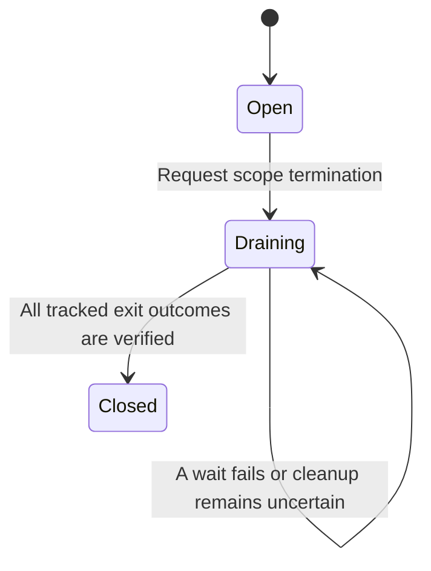

# Stop a group of processes

A scope is a group of processes with one lifetime. For example, put a development
server and a file watcher in the same scope so closing their workspace requests
cleanup of both. Processes cannot move between scopes. Stopping this group must
not stop another workspace's group.

## Requesting a stop

While open, the scope accepts processes. Termination changes it to draining,
meaning no new processes may join. A graceful signal gives programs time to exit;
remaining work is forced after the grace interval. A process can also exit on its
own. The monitor waits for the OS result and records whether cleanup was verified.

The domain's `Reaped` label alone is insufficient: it can carry an unverified
outcome after a failed wait. Such an entry stays in the registry. A later verified
correction can replace uncertainty, but a verified result is never downgraded.
Only verified terminal entries may be removed from bookkeeping.

## What the caller should do

Inspect `ScopeTerminationReport::all_verified()`, not just whether the method
returned `Ok`. If false, preserve the reported outcome and keep responsibility
with the supervisor; a deadline or successful signal is not evidence of exit.
The application may retry cleanup or report the unresolved process to its owner.
Do not build a separate kill operation from a diagnostic OS PID.

`with_scope` returns the closure's result and cleanup result separately. If its
caller is cancelled, cleanup continues on the active runtime. Retain the scope ID
and call `wait_scope_cleanup` when the result is needed. An empty domain aggregate
can remain draining until application-level cleanup completes; the chart shows
the caller-facing completion, not every internal aggregate transition.

## Model scope

`ScopeCleanup` abstracts one scope with two processes and three kinds of exit
evidence: none, unverified and verified. It checks that closing and pruning need
verified evidence and that later failures cannot erase a verified result. Signals,
OS containment, cleanup timing and another scope's isolation are not modeled.
Negative controls remove the evidence guards for closure and pruning.

Relevant Rust examples are the domain tests for unverified quarantine and
`fixtures/tests/scoped_integration.rs`. Their presence is source evidence; see
[verification](verification.md) for which commands actually ran.
