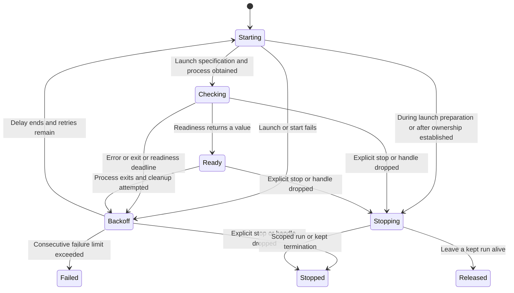

# Keep a named program available

A tunnel service may start a process and wait until it can return a usable URL.
Spawning the process is only the first step. The service's readiness check decides
when clients may use it. If it exits or readiness fails, the worker cleans up the
run and applies the restart policy.

## Readiness and retry policy

The worker asks the caller's `Service` to construct each launch and poll readiness.
A deadline also bounds a readiness callback that never returns. Readiness races
against process exit. The default restart delay doubles from one second to sixty
seconds. A run that stayed ready for the healthy interval clears previous failures;
its eventual exit then counts as a new failure. A configured maximum gives up when
failures exceed that maximum, not when they first equal it.

Starting or adopting a process is deliberately not interrupted halfway by a stop
request; the request waits until ownership is established. Stops can interrupt
launch preparation, readiness, ready waiting and backoff. Service names prevent
concurrent active workers with the same name in one service supervisor.

## Kept adoption and stop choices

A kept run can be adopted only before this worker has successfully started or
adopted a run, and only when its fingerprint matches. A mismatched earlier run is
terminated first. Replacement is refused if that termination is unverified.
`Leave` releases a kept process with its durable record. For an ordinary scoped
process, `Leave` still performs scope termination: it cannot turn scoped work into
an undocumented survivor.

A stopped status is a worker status, not proof all cleanup succeeded. Inspect the
returned stop outcome. Some retry paths attempt cleanup and continue even when
that result is uncertain; this atlas does not claim globally nonoverlapping OS
runs. See [kept processes](kept-processes.md) for the explicit replacement guard.

## Stop the host deliberately

A service name alone does not make a process survive its owner. For an orderly
restart, configure `ServiceOptions.kept` with `kept_processes(record_directory,
owner_label)`, start the named service, and wait for `handle.ready().await` to
return a value. Before tearing down the runtime, call
`handle.stop(ServiceStop::Leave).await` and inspect `left_running`. `Some(pid)`
reports that this worker released a kept run; `None` does not confirm a survivor.
Then shut down ordinary scoped work with `supervisor.shutdown().await`.

On the next application start, open the same kept-record directory and start the
service with the same `KeptName`. The worker compares the launch fingerprint
(command inputs and optional revision) and validates the recorded process identity.
A matching live predecessor can be adopted; a mismatch follows the guarded
replacement path above. The owner label is metadata, not a substitute for the name
claim or process identity. The [public usage example](../../README.md#services-and-kept-processes)
shows how the caller's service implementation plugs into these APIs.

| Action | Ordinary scoped service | Kept service |
| --- | --- | --- |
| Explicit `Leave`, awaited | Terminates its scope | Releases process and record; returns `left_running` |
| Explicit `Terminate`, awaited | Terminates its scope | Requests process/group termination; inspect outcome |
| Drop service handle | Worker receives `Leave`; cleanup still needs runtime time | Worker receives `Leave`; no awaited completion evidence |
| Supervisor shutdown alone | Stops registered scopes; also stop service workers to prevent further retries | Kept runs are outside that scope registry; stop each service handle explicitly |
| Abrupt host/runtime exit | No promise of verified asynchronous cleanup | No orderly handoff receipt; inspect durable records and live identity on restart |

Do not rely on handle drop as proof a release finished. Kept work can outlive the
application, but is not a machine-reboot persistence mechanism. Boot identity is
part of validating a recorded process. A missing record also does not prove every
descendant is gone; see [termination outcomes](kept-processes.md#inspect-what-termination-left-behind).

## Model scope

`ServiceAdoption` models one existing kept run, matching or mismatching
fingerprints, a supplied adoption-eligibility flag, and verified replacement. This is one decision:
the model assumes the worker maintained that flag correctly. The code initializes
it true and clears it after a successful start/adoption; that evolution is
source-reviewed, not modeled. The model does not cover all readiness or retry
transitions above. Controls remove fingerprint matching
and the verified-replacement guard. Restart arithmetic remains a pure contract
with Rust unit tests, not a fabricated persistent state machine.
